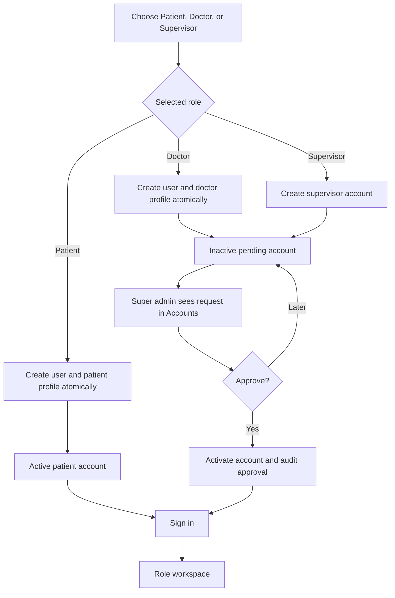
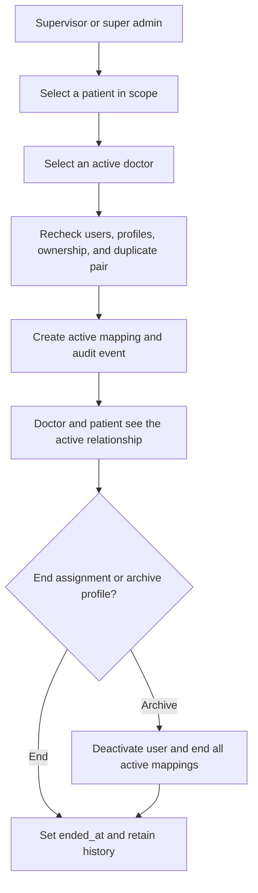
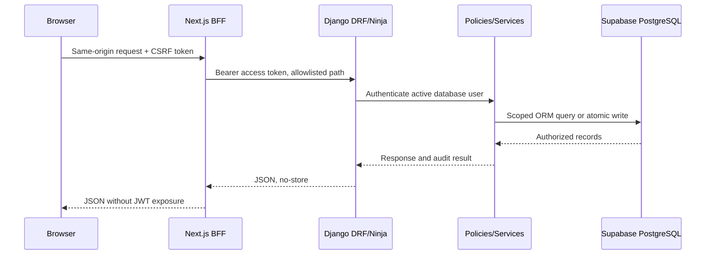
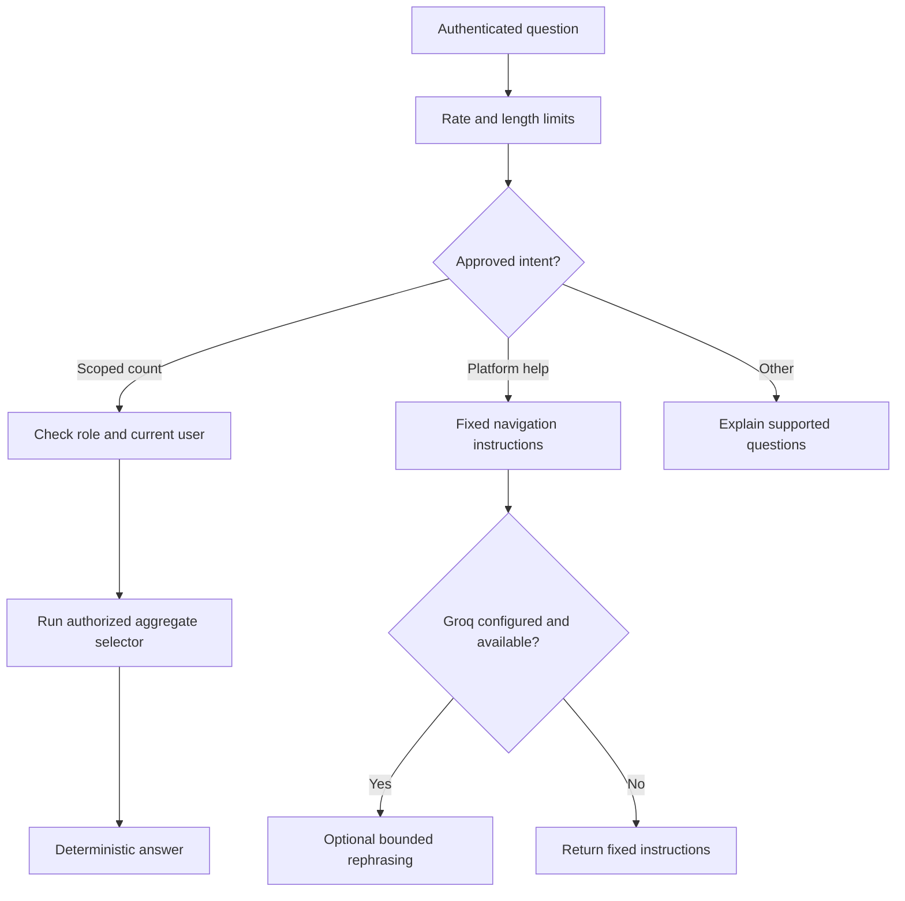

# Medora Healthcare — product and engineering specification

## Purpose

Medora coordinates patient records, professional profiles, and doctor assignments in a four-role workspace. It demonstrates the lifecycle of a healthcare operations platform with synthetic data. Its scope is account approval, profiles, directory browsing, assignments, audit visibility, and safe workspace guidance. Appointments, prescriptions, payments, medical diagnosis, and public clinician records are outside this product scope.

## User journeys

### Registration and approval

Patient signup requires name, email, and a strong password. Doctor signup also requires a recognized specialization and a normalized registration number. A supervisor request does not create a clinical profile. Public registration cannot request the super admin role. The super admin may provision supervisors and additional super admins directly. Provisioned accounts must change their temporary password before business API access.

### Assignment lifecycle

The mapping table retains previous assignments. A partial PostgreSQL unique constraint permits only one active mapping for each patient–doctor pair. Assignments and archival use transactions and row locks. A supervisor may assign an active doctor from the directory to a patient they manage. Ownership transfer is limited to super admins and preserves assignment history.

## Role capabilities

| Capability | Super Admin | Supervisor | Doctor | Patient |
|---|---:|---:|---:|---:|
| Browse safe doctor directory | Yes | Yes | Yes | Yes |
| View patient profile | All | Managed | Actively assigned | Own |
| Edit patient demographics | All | Managed | No | Own allowed fields |
| Edit allergies and history | All | Managed | No | No |
| Create or archive patient and doctor profiles | All | Managed | No | No |
| Assign or end doctors | All | Managed patients | No | No |
| Edit own professional details | — | — | Yes | — |
| Approve doctor and supervisor requests | Yes | No | No | No |
| Create supervisor or super admin accounts | Yes | No | No | No |
| View audit log | All | Recent scoped activity | No | No |

Current database state controls permissions. A stale JWT role claim never grants access. Querysets are scoped before UUID lookup. Administrators can review account status without a role-change payload. Doctor directory records omit private contact details, ownership, and account email.

## Data model and lifecycle

- **User** has a UUID, normalized unique email, name, role, password hash, activity state, approval state, creator, and temporary-password flag. Super admins have server-controlled staff and superuser flags. Multiple super admins are supported.
- **PatientProfile** links one-to-one to a patient user. It stores demographic and bounded clinical fields, manager, creator, and archive timestamp. Self-registered patients begin without a manager.
- **Specialization** normalizes professional specialties with unique names and slugs. Curated values are inserted by migration.
- **DoctorProfile** links one-to-one to a doctor user and to a specialization. It stores registration number, qualifications, biography, experience, manager, creator, and archive timestamp.
- **PatientDoctorMapping** links patient and doctor profiles, records who assigned and ended it, and retains its timeline. `ended_at = NULL` means active.
- **AuditLog** stores action, resource, actor, request ID, outcome, timestamp, and allowlisted non-sensitive metadata. Application writes are append-only.

Composite indexes serve supervisor lists, doctor directory specialty filtering, each side of active assignment lookup, and recent audit queries. UUIDs break ordering ties in paginated lists. Archival protects foreign-key history and ends current mappings. Account suspension blocks access immediately while preserving mapping history. An archived profile cannot be reactivated through generic account updates.

## System boundaries

DRF owns account, patient, doctor, and mapping operations. Ninja provides dashboard aggregates, admin audit pagination, and assistant chat. Both use the same ORM and policies. The full contract has 25 operations in [docs/api.md](docs/api.md). The BFF keeps tokens in HttpOnly cookies and coordinates refresh across tabs when Web Locks are available.

## Assistant behavior

The assistant recognizes approved variants of navigation and aggregate questions. Counts run against role-scoped selectors. Only fixed, generic platform instructions may reach Groq. Free text, patient names, medical history, clinical data, credentials, and conversation transcripts are never sent to the provider. The frontend keeps up to 20 exchanges in memory, offers role-specific suggestions, and supports retry and clearing. The service does not provide diagnosis, medical advice, arbitrary data access, or actions.

## Interface specification

The public site introduces the platform with local illustrative photography, restrained editorial typography, clear registration and login links, and role explanations. The authenticated shell provides persistent navigation, a compact header, role-aware overview counts, searchable paginated tables, forms, status feedback, and an assistant panel. The palette uses warm white, deep navy, medical teal, and sage. Motion is limited to brief entrance and hover transitions and is disabled under `prefers-reduced-motion`.

On mobile, navigation opens from the header and forms and tables remain usable at narrow widths. Dialogs manage focus, inputs have labels, and loading or error states are visible. Dashboard counts and tables come from authenticated APIs. The page does not display fabricated metrics.

## Configuration and delivery

- Django 5.2 LTS, DRF, Django Ninja, SimpleJWT, psycopg, and Supabase PostgreSQL.
- Next.js App Router, React, TypeScript strict mode, Tailwind CSS, TanStack Query, React Hook Form, and accessible dialog primitives.
- Environment-only secrets in a private root `.env`. Next.js uses server-only origins in `frontend/.env.local`. The Supabase publishable key is not used.
- Local development runs through Python and Node commands in [README.md](README.md). Tests require a disposable local PostgreSQL database. A deployment can use a Python host for Django and a Node host for Next.js.
- Generated DRF and Ninja OpenAPI descriptions, Postman collection, CI checks, migrations, and synthetic demo seeding are included.

## Acceptance checks

1. Patients register and see only their own profile and care team.
2. Doctor and supervisor registrations remain inactive until a super admin approves them.
3. A super admin can create supervisors and additional super admins.
4. Supervisors manage scoped patients and doctors, assign doctors, and end assignments.
5. Doctors see only actively assigned patients and can edit only their allowed professional fields.
6. Cross-role and cross-owner requests receive the documented 403 or 404 result.
7. Dashboard counts match database state, and the assistant answers only approved scoped questions.
8. Migrations, tests, lint, type checking, and production build complete successfully.
